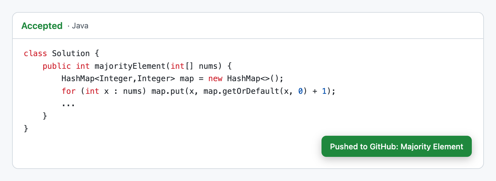
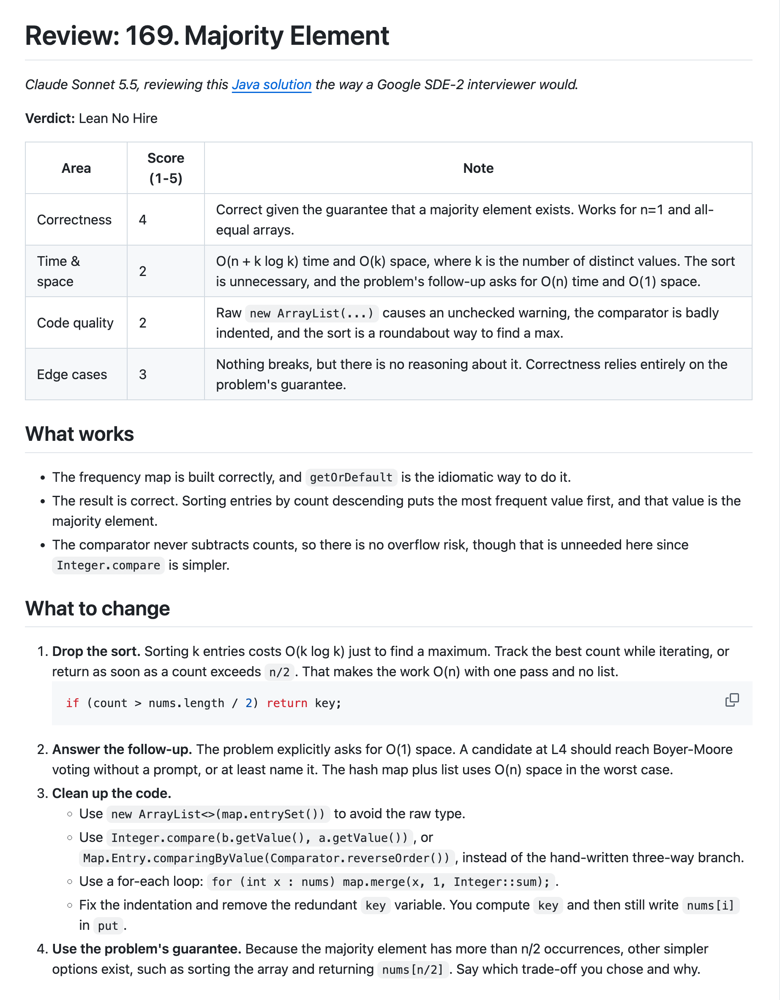
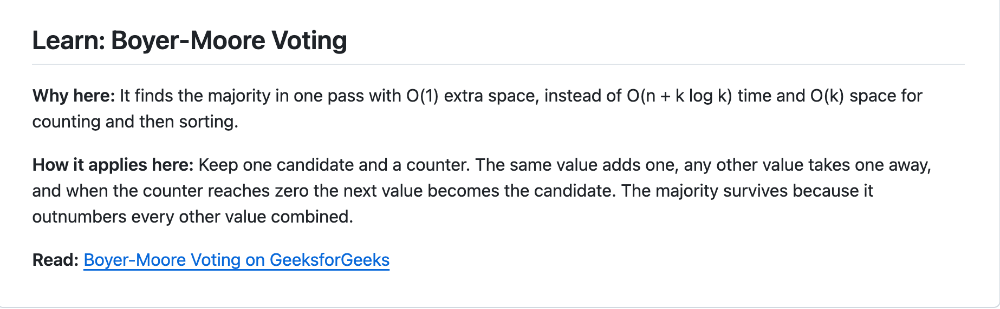
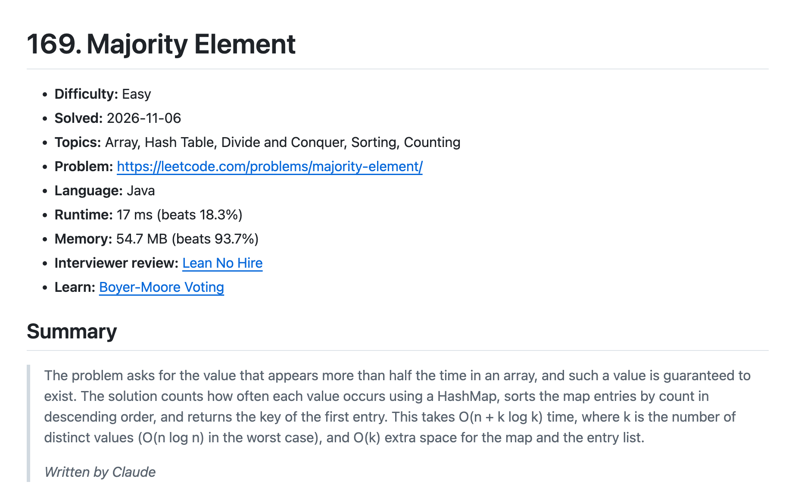
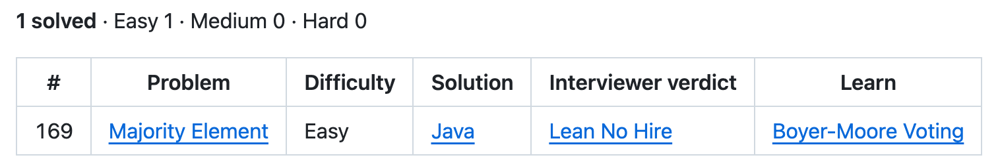
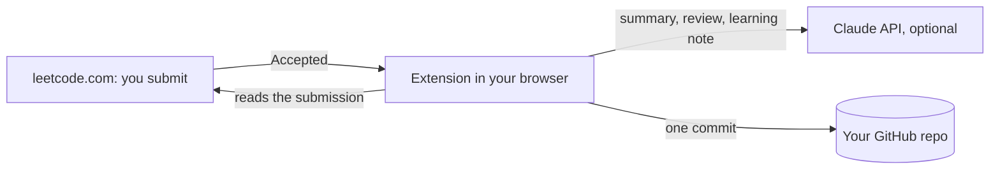
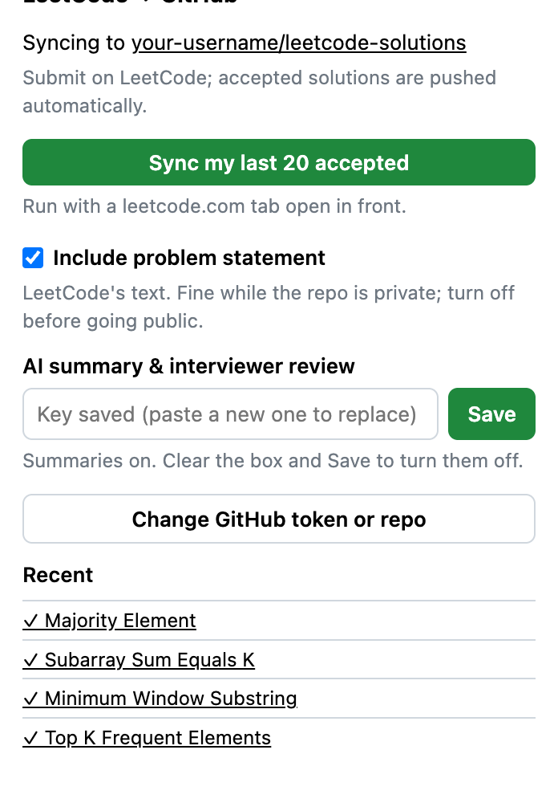

# LeetCode → GitHub Sync

**Solve a problem on LeetCode. It's on GitHub a few seconds later, with an interviewer's review.**

A Chrome extension that commits every accepted LeetCode submission to your own GitHub repo. With an optional
Claude API key, each solution also gets:

- **a short summary** of the problem and your approach;
- **an interviewer-style review** written as a Google SDE-2 (L4) interviewer would: a hire verdict, scores,
  what to change, and a better approach if there is one;
- **a learning note** when a technique you didn't use fits better, linked to a GeeksforGeeks tutorial.

No server, no cookies to copy, no GitHub Actions. It runs in your browser with your existing LeetCode login.



## What lands in your repo

```
problems/0169-majority-element/
  solution.java     your accepted code
  README.md         difficulty, solved date, topics, runtime/memory, summary, problem statement
  REVIEW.md         the interviewer review, plus a learning note
README.md           an index of everything you've solved, regenerated on every push
```

One commit per accepted submission, dated to when you submitted, so your GitHub contribution graph shows the
days you actually practised.

👉 **[See a full sample](example/)**: real output for *169. Majority Element*.

### The interviewer review

Every review follows the same structure: a verdict (Strong Hire to No Hire), 1–5 scores for correctness,
complexity, code quality and edge cases, what works, a numbered list of what to change, a better approach with
code, and the follow-up questions an interviewer would ask.



### The learning note

When the review spots a concept, pattern or algorithm you didn't use, it ends with a short note: why it fits
this problem, how it applies, and a link to the technique's GeeksforGeeks article. A technique that comes up again
keeps the same name and links back to the problem where you first met it.



### Each problem's README



### The index



## How it works



1. A small script on leetcode.com watches for LeetCode's own "Accepted" result. **Run** never triggers it, only
   **Submit**.
2. The extension reads the submission (code, language, runtime, memory) through LeetCode's API, using the session
   you're already logged in with.
3. If you added a Claude API key, it asks Claude for the summary, the review and the learning note, in parallel.
4. It writes everything as **one commit** through GitHub's Git Data API, dated to your submission time.

Details that make it reliable:

- **No duplicates.** Already-pushed submissions are tracked in `.sync-state.json`, so syncing again only fills in
  what's missing.
- **Never rolls back.** An older submission never overwrites a newer solution.
- **Safe with quick submits.** Pushes run one at a time and retry if the branch moved.
- **Re-solves.** A new accepted solution replaces the old one; earlier versions stay in git history.

## Install (about 3 minutes)

1. **Make a repo for your solutions** on GitHub, e.g. `leetcode-solutions`. Private is best while problem
   statements are on (see below).
2. **Make a GitHub token** that can only touch that repo:
   [create a fine-grained token](https://github.com/settings/personal-access-tokens/new?name=LeetCode+Sync&expires_in=365&contents=write).
   - **Repository access:** *Only select repositories* → your solutions repo
   - **Permissions → Repository → Contents:** *Read and write*
3. **Load the extension.** Download this repo (**Code → Download ZIP**, or `git clone`). In Chrome, open
   `chrome://extensions`, turn on **Developer mode**, click **Load unpacked** and choose the `extension` folder.
4. **Connect it.** Pin *LeetCode to GitHub Sync* from the puzzle-piece menu, click it, enter your repo
   (`your-username/leetcode-solutions`) and the token, and **Save**.
5. **Reload any open LeetCode tabs.**
6. **Optional: add a Claude API key** from [platform.claude.com](https://platform.claude.com/settings/keys) under
   **AI summary & interviewer review**. Without one, solutions and READMEs are still pushed, just without the
   summary, review and learning note.



**Already solved problems before installing?** Open any leetcode.com page, click the extension and press
**Sync my last 20 accepted**. It also fills in anything missing on problems already in the repo.

## What it costs

GitHub and the extension are free. The Claude API is pay-as-you-go, and only if you add a key:

| Per accepted submission | Model | Cost |
|---|---|---|
| Summary | Claude Opus 5.5, low effort | ~1¢ |
| Interviewer review | Claude Sonnet 5.5 | ~3–5¢ |
| Learning note | Claude Sonnet 5.5, low effort | under 1¢ |
| **Total** | | **~4–6¢** |

At one or two problems a day, that's about $2–5 a month.

## Privacy and security

- **Your keys stay in your browser.** The GitHub token and Claude key are kept in the extension's local storage.
  The LeetCode page itself never sees them.
- **The GitHub token can only write to one repo**, and only its contents.
- **It talks to three places only:** leetcode.com (to read your submission), api.github.com and, if you add a key,
  api.anthropic.com. There's no other server in between.
- **The code is small and readable:** about 1,000 lines of plain JavaScript and HTML, no build step. The only
  third-party code is Anthropic's official SDK, bundled in `extension/vendor/`.

## Problem statements and going public

**Include problem statement** is on by default, so each README has the full problem to revise from. That text is
LeetCode's, which is fine in a private repo. To make your solutions repo public, turn the option off first and
remove the statements from the files *and* the git history.

## Troubleshooting

The extension shows a red note on the page and keeps a **Recent** list in its popup.

- **"Token is invalid or expired":** make a new token (install step 2) and use **Change GitHub token or repo**.
- **"Couldn't read the submission":** you're logged out of LeetCode in this browser.
- **Nothing happens on Accepted:** reload the LeetCode tab. If LeetCode changed its site, **Sync my last 20
  accepted** still works.
- **"Skipped summary/review":** the solution was still pushed. Fix the Claude key if the note says so, then run
  **Sync my last 20 accepted** to fill in the rest.

## Project structure

```
extension/
  manifest.json     Chrome extension manifest (MV3)
  page-hook.js      runs on leetcode.com; spots LeetCode's "Accepted" result
  content.js        reads the submission through LeetCode's API, shows the on-page note
  background.js     queues pushes, one at a time
  github.js         builds the files and the commit (Git Data API)
  claude.js         the summary, review and learning-note prompts
  gfg.js            GeeksforGeeks links for about 40 common techniques
  markdown.js       turns LeetCode's problem HTML into Markdown
  popup.html/.js    the settings popup
  vendor/           Anthropic's official TypeScript SDK, bundled (MIT)
example/            sample output for one problem
```

To update the bundled SDK:

```bash
npm i @anthropic-ai/sdk@<version> esbuild
echo 'export { default } from "@anthropic-ai/sdk";' > entry.mjs
npx esbuild entry.mjs --bundle --format=esm --platform=browser --minify --outfile=extension/vendor/anthropic-sdk.js
```

## License

[MIT](LICENSE). Not affiliated with LeetCode, GitHub, GeeksforGeeks or Anthropic.
